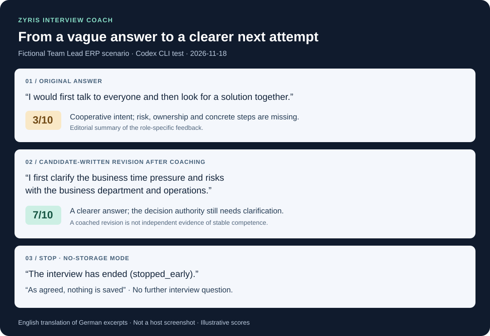

# Interview Coach

[](https://github.com/draftm0de/ai.plugin.interview-coach/actions/workflows/validate.yml)
[Deutsch](README.md) | [English](README.en.md)


Practice job interviews with role-specific questions, concrete feedback and evidence-based learning progress in Claude, ChatGPT or Codex.

**[Install](docs/en/installation.md) · [Usage](docs/en/usage.md) · [Examples](docs/en/screens.md) · [FAQ](docs/en/faq.md) · [Documentation](docs/en/README.md)**

**Installation:** [Claude](docs/en/installation.md#claude-desktop) · [Claude Code](docs/en/installation.md#optional-terminal-installation) · [Codex Desktop](docs/en/installation.md#codex-desktop). Marketplace: `https://github.com/draftm0de/ai.plugins`. The user confirms both plugins are present in the published marketplace. Local changes and their GUI acceptance are separate.

## Who it is for

Use this when you want to prepare for a specific vacancy, practise clearer answers, rehearse a realistic interview or review what to improve before the next conversation. Technical roles can include coding, debugging, code review and system design exercises.

The coach adapts questions and criteria to your role and seniority. It distinguishes your own answers from suggested wording and does not invent professional experience or achievements.

## What it looks like



*English translation of rendered excerpts from a fictional Codex CLI test, not a screenshot of Claude or ChatGPT. Scores illustrate one response, not a guaranteed result. [Read the example and its provenance](docs/en/screens.md).*

1. Choose your language, training goal and whether to save progress.
2. Answer one question at a time in coached modes.
3. Receive an overall score out of 10, relevant criteria, strengths and specific improvements.
4. Try again in your own words; a coached revision is not proof of stable competence.
5. Say `stop` whenever you want to finish.

## Capabilities and modes

| Mode | Use it for | Example request |
|---|---|---|
| `general` | Broad interview practice | “Practise general interview questions for a senior developer.” |
| `targeted` | A specific role, employer and interview | “Use my CV and this vacancy to prepare a targeted interview.” |
| `drill` | One recurring weakness | “Help me make my answers more concrete.” |
| `mock` | An uninterrupted simulation | “Run a mock interview; give feedback at the end.” |
| `briefing` | A concise preparation summary | “Summarize what I should review before this interview.” |

Research uses available public professional sources and marks uncertainty. Employer/interviewer research requires browsing access. [Usage guide](docs/en/usage.md).

## Quick start

Open the [installation guide](docs/en/installation.md) and choose Claude or Codex. After installation, select the plugin in a new chat and send the documented first prompt. This user path does not require a source checkout.

## Usage

After installation, ask:

> Use interview-coach and run setup. I want to practise for a Team Lead role. Use English. Do not save anything.

For targeted preparation, provide your approved profile/CV and the job posting privately. Do not add them to this repository. Unknown interviewer names do not prevent training.

| Control | Result |
|---|---|
| `stop` / `beenden` | End questioning immediately; summarize the answers given |
| `pause` | Request a resumable checkpoint when verified storage is available |
| Do not save (`Nicht speichern`) | No skill-managed files, workspace, exports or saved learning state |

In `mock`, feedback is deferred until the end. Platform chat history has separate retention settings.

## Storage and privacy

You can practise without persistence. For learning across sessions, use a separate private workspace and a verified storage adapter. A hosted sandbox or an uploaded attachment does not automatically provide durable cross-chat storage.

The local Python CLI supports `init`, `status`, `finish`, `resume`, `recover`, `validate` and language preferences. It protects immutable runs, checks for stale state and supports recovery after partial writes. See [storage and recovery](docs/en/storage.md) for commands and limitations.

## Project status

This MVP uses versionless plugin manifests and repository import through Draftmode AI Plugins. There is no customer portal, payment system, license server or claimed listing in an additional official plugin directory.

Local persistence and packaging have deterministic tests. CLI model journeys use fictional scenarios and heuristic checks. Native Claude/ChatGPT/Codex platform acceptance remains separate; a passing model test does not prove host UI or storage integration.

License: [MIT](LICENSE). Isolated native CLI checks are recorded in the [release evidence](docs/en/release-evidence.md); graphical acceptance remains pending.

## Development

The [test guide](tests/README.md) describes the shared layout by test type. `make test` runs unit, integration and contract tests; native host and model tests are started separately.


```bash
make test          # deterministic unit, integration and contract tests; no model calls
make check-plugin  # validate versionless host manifests
```

Tests require no additional Python packages such as pytest. Management tools require Git and Python 3.10+; the local workspace helper requires Python 3.10+ but not Git. Make is optional. See [development and testing](docs/en/development.md) for model tests and repository boundaries.

The [canonical skill](skills/interview-coach/SKILL.md) is the single runtime source. User documentation lives in [docs/](docs/en/README.md).

Publisher: **draftmode** · [draftmode.io](https://draftmode.io) · Author: **Peter Fux**.

Documentation prepared with Plugin Manager.
