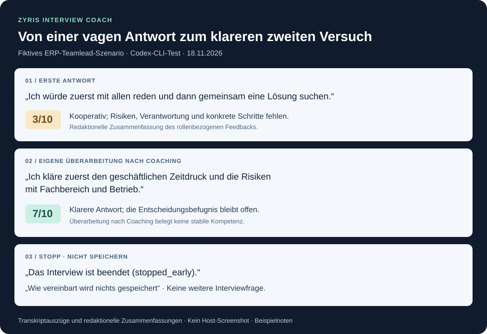

# Interview Coach

[](https://github.com/draftm0de/ai.plugin.interview-coach/actions/workflows/validate.yml)
[Deutsch](README.md) | [English](README.en.md)


Übe Vorstellungsgespräche mit rollenbezogenen Fragen, konkretem Feedback und einem durch eigene Antworten belegten Lernstand – in **Claude Code** und **Codex**. Ein Projekt verwaltet mehrere Bewerber mit eigenem Profil, CV, Stellen, Runs und Lernstand.

**[Installation](docs/de/installation.md) · [Nutzung](docs/de/usage.md) · [Speicherung](docs/de/storage.md) · [Beispiele](docs/de/screens.md) · [FAQ](docs/de/faq.md) · [Dokumentation](docs/de/README.md) · [Abnahme](docs/acceptance.md)**

**Installation:** [Claude Code](docs/de/installation.md#claude-code) · [Codex](docs/de/installation.md#codex). Marketplace: `https://github.com/draftm0de/ai.plugins`. Der Stand der Veröffentlichung dieser Erweiterung ist nicht belegt; Host- und Live-Abnahme sind offen ([Abnahme](docs/acceptance.md)).

## Für wen ist das gedacht?

Für Bewerber, die sich auf eine konkrete Stelle vorbereiten, klarer antworten, ein realistisches Interview proben oder gezielt Schwächen trainieren möchten. Technische Rollen können Coding, Debugging, Code Review und Systemdesign üben.

Fragen und Kriterien richten sich nach Rolle und Erfahrungsniveau. Der Coach trennt eigene Antworten von Formulierungsvorschlägen und erfindet keine Berufserfahrung oder Erfolge.

## So sieht es aus



*Gerenderte Auszüge eines fiktiven Codex-CLI-Tests, kein Host-Screenshot. Noten bewerten einzelne Antworten und versprechen kein Ergebnis. [Herkunft und vollständiger Ablauf](docs/de/screens.md).*

1. Einrichten: Speicherart wählen – genau zwei Optionen: **Lokal**, **Nicht speichern** – bei Lokal danach den Speicherordner bestätigen.
2. Bewerber anlegen (`candidate-create`): mit CV-Import (PDF, DOCX, Markdown) oder Profilaufbau ohne CV.
3. Allgemein trainieren (`candidate-training`) oder eine Stelle vorbereiten (`job-create`) und dafür trainieren (`job-training`).
4. Im begleiteten Modus eine Frage pro Turn beantworten; Gesamtbewertung, Kriterien, Stärken und Verbesserungen erhalten.
5. Mit `stop` jederzeit beenden.

## Funktionen und Modi

| Modus | Zweck | Beispiel |
|---|---|---|
| `general` | Allgemeines Training | „Übe Interviewfragen für eine Senior-Entwicklerrolle.“ |
| `targeted` | Konkrete Stelle und Arbeitgeber | „Nutze meinen Lebenslauf und diese Stellenanzeige.“ |
| `drill` | Einzelne Lernlücke | „Hilf mir, konkreter zu antworten.“ |
| `mock` | Ununterbrochene Simulation | „Gib Feedback erst am Ende.“ |
| `briefing` | Kompakte Vorbereitung | „Fasse die wichtigsten Fakten und Rückfragen zusammen.“ |

Recherche nutzt verfügbare öffentliche berufliche Quellen und kennzeichnet Unsicherheit. Arbeitgeber- und Interviewerrecherche braucht Browserzugriff. [Details](docs/de/usage.md).

## Schnellstart

Öffne die [Installationsanleitung](docs/de/installation.md). Danach in Claude Code `/interview-coach:interview-coach setup` bzw. in Codex `$interview-coach` verwenden – oder einfach schreiben: „Starte die Einrichtung von interview-coach“. Die Einrichtung läuft bei der ersten Nutzung oder mit `setup`; eine automatische Aktivierung beim Öffnen eines Projekts wird nicht behauptet.

| Skill | Zweck | Claude Code | Codex |
|---|---|---|---|
| `interview-coach` | Einstieg, Setup | `/interview-coach:interview-coach` | `$interview-coach` |
| `candidate-create` | Bewerber anlegen | `/interview-coach:candidate-create` | `$candidate-create` |
| `candidate-training` | Allgemeines Training | `/interview-coach:candidate-training` | `$candidate-training` |
| `job-create` | Stelle vorbereiten | `/interview-coach:job-create` | `$job-create` |
| `job-training` | Training für eine Stelle | `/interview-coach:job-training` | `$job-training` |

Die Aufrufschreibweisen folgen der Host-Dokumentation; ein nativer Befehl `:job-create` wird nicht behauptet. Details in der [Nutzung](docs/de/usage.md).

| Steuerung | Ergebnis |
|---|---|
| `stop` / `beenden` | Fragen sofort beenden und vorhandene Antworten zusammenfassen |
| `pause` | Fortsetzbaren Checkpoint speichern (nur bei gewählter Speicherung) |
| **Nicht speichern** | Nichts wird persistiert: keine Dateien, Zeiger, Exporte oder Lernstände |

## Speicherung und Datenschutz

Genau zwei Optionen: **Lokal** (von dir benanntes Verzeichnis), **Nicht speichern**. „Dateien selbst verwalten“ entfällt. Private Daten liegen außerhalb des installierten Plugins. Es werden keine Tokens erfragt. [Speicherung, Formate und Wiederherstellung](docs/de/storage.md).

## Projektstatus

MVP mit versionslosen Plugin-Manifesten und Repository-Import über Draftmode AI Plugins. Lizenz: [MIT](LICENSE). Kein Kundenportal, Zahlungssystem oder Lizenzserver; eine Aufnahme in ein zusätzliches offizielles Plugin-Verzeichnis wird nicht behauptet.

Lokale Speicherung, Extraktion und Paketierung besitzen deterministische Tests. Modellszenarien verwenden fiktive Daten und heuristische Prüfungen. Host-Abnahme für Claude Code und Codex mit isolierten Profilen ist offen; Ergebnisse und Lücken stehen in der [Abnahmematrix](docs/acceptance.md). Der frühere [Release-Nachweis](docs/de/release-evidence.md) ist Historie.

## Entwicklung

Die [Testübersicht](tests/README.md) beschreibt die gemeinsame Struktur nach Testart. `make test` prüft Unit-, Integrations- und Vertragstests; native Host- und Modelltests werden separat gestartet.


```bash
make test          # Deterministische Unit-, Integrations- und Vertragstests ohne Modellaufrufe
make check-plugin  # Versionslose Host-Manifeste prüfen
```

Die Tests benötigen keine zusätzlichen Python-Pakete wie pytest. Git und Python 3.10+ werden für die Verwaltungswerkzeuge benötigt; die Laufzeit benötigt Python 3.10+. PDF-Import braucht `pdftotext`, `mutool` oder `pypdf` (wird nicht installiert). Make ist optional. [Entwicklung und Tests](docs/de/development.md).

Die fünf Skills unter [skills/](skills/) und die gemeinsame Runtime unter [skills/_shared/](skills/_shared/) definieren das Verhalten; maßgeblich ist [SCOPE.md](SCOPE.md). Nutzerdokumentation liegt unter [docs/de/](docs/de/README.md) und wird direkt auf GitHub dargestellt.

Herausgeber: **draftmode** · [draftmode.io](https://draftmode.io) · Autor: **Peter Fux**.

Dokumentation erstellt mit Plugin Manager.
