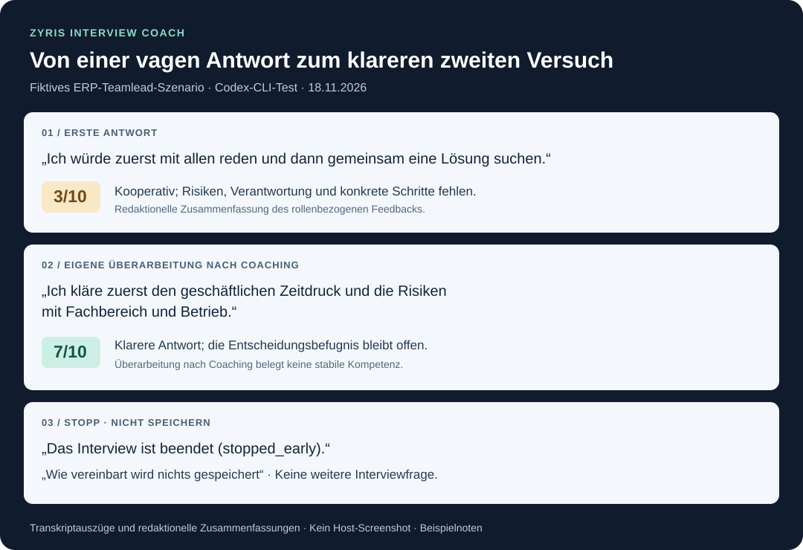
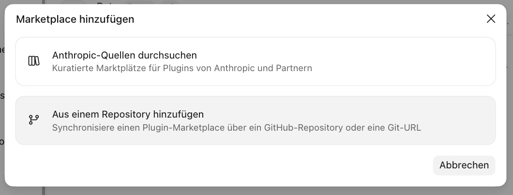
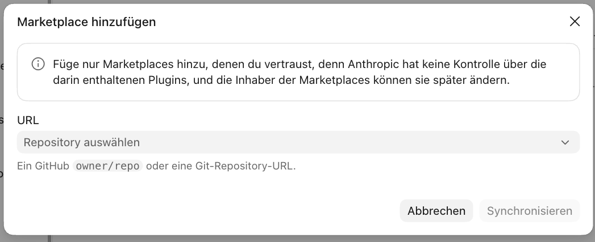

# Beispiele und Vorschauen

[Deutsch](./screens.md) | [English](../en/screens.md)

[Start](../../README.md) · [Dokumentation](README.md) · [Installation](installation.md) · [Nutzung](usage.md) · [Beispiele](screens.md) · [FAQ](faq.md) · [Speicherung](storage.md) · [Entwicklung](development.md)

## Vorschau

**Gerenderte Transkriptvorschau, kein Screenshot einer Host-Oberfläche.** Grundlage sind bereits in der bisherigen Dokumentation veröffentlichte Auszüge des fiktiven Codex-CLI-Ablaufs `teamlead_coaching`, dort als am 18.11.2026 geprüft beschrieben. Diese Aktualisierung führt den Modelltest nicht erneut aus und liest keine ignorierten Rohprotokolle. Gestaltung und Auswahl sind redaktionell. Modellantworten und Noten können variieren.

Die [versionierte Testvorlage](../../tests/behavior/fixtures/journeys/teamlead_coaching.json) enthält fiktive Prompts. Die Originalgrafik bleibt unter `docs/assets/coaching-preview.svg` erhalten; die neuen Fassungen sind sprachlich vollständig lokalisiert.

## Beispielablauf

### 1. Eine vage Antwort erhält konkretes Feedback

Fiktive Frage: Ein Fachbereich verlangt eine riskante sofortige ERP-Änderung. Wie gehst du vor?

Antwort aus der Testvorlage:

> Ich würde zuerst mit allen reden und dann gemeinsam eine Lösung suchen.

Bereits veröffentlichter Modellauszug:

> **Gesamtbewertung: 3/10** — Deine Antwort zeigt Gesprächsbereitschaft, bleibt für einen Team Lead ERP Platform bei einer riskanten Sofortänderung aber zu unkonkret.

Das Feedback behandelt Abstimmung, Risiken, Verantwortung und konkrete Schritte. Ein Formulierungsvorschlag bleibt von eigenen Erfahrungen getrennt.

### 2. Der Kandidat überarbeitet seine Antwort

Zweiter, im Test vorgegebener eigener Versuch:

> Ich kläre zuerst den geschäftlichen Zeitdruck und die Risiken mit Fachbereich und Betrieb. Dann prüfe ich sichere Alternativen, lasse Auswirkungen bewerten und dokumentiere die Entscheidung mit Verantwortlichem und nächstem Termin.

Bereits veröffentlichter Modellauszug:

> **Gesamtbewertung: 7/10 — gegenüber 3/10 für deine ursprüngliche Antwort.** Deine neue Formulierung macht aus allgemeiner Gesprächsbereitschaft ein konkretes Vorgehen. Für die riskante Sofortänderung bleibt allerdings offen, wer sie tatsächlich freigibt.

Die Überarbeitung nach Feedback ist kein zusätzliches unabhängiges Szenario und kein Nachweis stabiler Kompetenz.

### 3. Stopp beendet das Interview

Befehl: `stop`. Bereits veröffentlichte Modellauszüge:

> Das Interview ist beendet (**stopped_early**). Drei Szenarien wurden beantwortet, Frage 1 zusätzlich überarbeitet; eine geplante Gesamtzahl war nicht festgelegt.

> Wie vereinbart wird nichts gespeichert; diese Zusammenfassung bleibt ausschließlich im Gespräch.

Keine weitere Interviewfrage folgt. Die drei Szenarien behandeln Prioritäten, Entscheidungsverantwortung und Störungsbehandlung; die Überarbeitung zählt nicht als viertes unabhängiges Szenario.

## Echte Screenshots

Vom Nutzer bereitgestellte Originalaufnahmen: Claude Desktop, macOS, deutsche Oberfläche, 18.11.2026. Sie zeigen die Repository-Auswahl, keine erfolgreiche Installation. Die App-Version ist im Bild nicht sichtbar; separat wurden am selben Tag lokale App-Metadaten mit Version 5.11492.5 gelesen. Eine direkte Zuordnung dieser Version zu den Aufnahmen ist nicht bestätigt.

*Originalaufnahme vom Nutzer, 18.11.2026, 13:59:26 Uhr laut Dateiname: „Aus einem Repository hinzufügen“. Unverändert übernommen.*

*Originalaufnahme vom Nutzer, 18.11.2026, 13:59:42 Uhr laut Dateiname: leeres Repository-Feld, noch keine Synchronisierung. Unverändert übernommen.*

Weitere gelieferte Bilder belegen **Einstellungen → Anpassungen → Plugins → + Hinzufügen → Marketplace hinzufügen**. Sie werden wegen sichtbarer Kontodaten beziehungsweise persönlicher Plugin-Bestände nicht übernommen. Die obigen Dialogbilder enthalten keine sichtbaren Kontokennungen. Keine Codex- oder ChatGPT-Installationsscreenshots vorhanden.

## Aufnahmecheckliste

| Aufnahme | Nachweis |
|---|---|
| Installation und Auswahl | Tatsächlicher Plugin-Eintrag im Host |
| Einrichtung | Sprache und Speicherwahl einschließlich „Nicht speichern“ |
| Feedback | Rollenbezogene Bewertung einer Antwort |
| Überarbeitung | Eigene Antwort getrennt vom Modellvorschlag |
| Stopp | Sofortiges Ende und korrekter Speicherstatus |
| Wiederaufnahme | Gespeicherter Checkpoint in einer neuen Sitzung |

Nur fiktive Testdaten verwenden. Host, Aufnahmedatum, Version und UI-Sprache festhalten. Bilder unter `docs/assets/` mit beschreibendem Alternativtext ablegen; Identitäten, private Pfade, Zugangsdaten und andere Gespräche ausschließen. Original-Screenshots nicht als übersetzte Oberfläche ausgeben.

### Offene Installationsaufnahmen (18.11.2026)

Für Claude Desktop ist der Menüpfad bis zum Repository-Dialog durch Nutzeraufnahmen belegt. Offen bleiben eingegebene freigegebene Katalogadresse, erfolgreiche Synchronisierung, Produktauswahl, Installation, erster Start und Update. Für Codex und ChatGPT fehlen weiterhin die Installationsaufnahmen. Neue Aufnahmen nur mit fiktiven Daten in einem isolierten Profil; unter `docs/assets/de/` mit Oberfläche, OS, Version, Datum, Herkunft, Alt-Text und Bildunterschrift ablegen.
