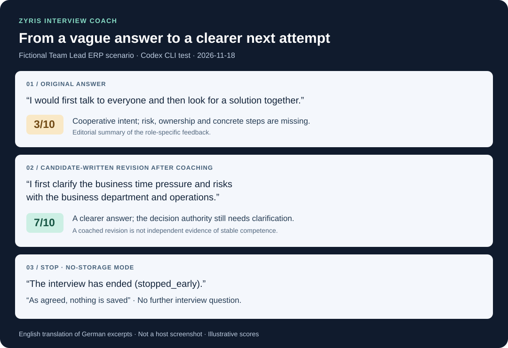

# Examples and previews

[Deutsch](../de/screens.md) | [English](./screens.md)

[Home](../../README.en.md) · [Documentation](README.md) · [Install](installation.md) · [Use](usage.md) · [Examples](screens.md) · [FAQ](faq.md) · [Storage](storage.md) · [Development](development.md)

## Preview

**Rendered transcript preview, not a host UI screenshot. English translation of the previously published German excerpts.** The earlier documentation attributes these excerpts to the fictional Codex CLI `teamlead_coaching` journey reviewed on 2026-11-18. This update neither reruns that model test nor reads ignored raw transcripts. Layout and selection are editorial; responses and scores vary.

The [versioned fixture](../../tests/behavior/fixtures/journeys/teamlead_coaching.json) contains fictional prompts. The original graphic remains at `docs/assets/coaching-preview.svg`; the new variants are fully localized.

## Example walkthrough

All candidate and model excerpts below are **English translations of the German originals**, not model outputs generated in English. [German originals](../de/screens.md).

### 1. A vague answer receives concrete feedback

Fictional question: A business department requests a risky immediate ERP change. How would you handle it?

Candidate answer from the fixture:

> I would first talk to everyone and then look for a solution together.

Previously published model excerpt, translated:

> **Overall assessment: 3/10** — Your answer shows willingness to communicate, but remains too vague for a Team Lead ERP Platform facing a risky immediate change.

Feedback covers alignment, risk, ownership and concrete steps. Suggested wording remains separate from actual experience.

### 2. The candidate revises the answer

Scripted candidate-written second attempt, translated:

> I first clarify the business time pressure and risks with the business department and operations. Then I check safe alternatives, have the impacts assessed and document the decision with an owner and next review date.

Previously published model excerpt, translated:

> **Overall assessment: 7/10 — compared with 3/10 for your original answer.** Your new wording turns general willingness to communicate into a concrete approach. For the risky immediate change, however, it remains unclear who actually approves it.

The coached revision is not an additional independent scenario or evidence of stable competence.

### 3. Stop ends the interview

Command: `stop`. Previously published model excerpts, translated:

> The interview has ended (**stopped_early**). Three scenarios were answered, with question 1 also revised; no planned total had been set.

> As agreed, nothing is saved; this summary remains exclusively in the conversation.

No further interview question follows. The three scenarios cover priority, decision ownership and incident response; the revision is not counted as a fourth independent scenario.

## Native screenshots

Native Claude, ChatGPT and Codex screenshots are not included. Rendered examples do not establish native host acceptance.

## Capture checklist

| Capture | Evidence |
|---|---|
| Installation and selection | Actual plugin entry in the host |
| Setup | Language and storage choice, including no-storage mode |
| Feedback | Role-specific answer assessment |
| Revision | Candidate answer separate from model suggestion |
| Stop | Immediate end and truthful save status |
| Resume | Persisted checkpoint loaded in a new session |

Use fictional fixtures only. Record host, date, version and UI language. Store reviewed images in `docs/assets/` with descriptive alt text; exclude identities, private paths, credentials and unrelated chats. Do not present translated graphics as original screenshots.
